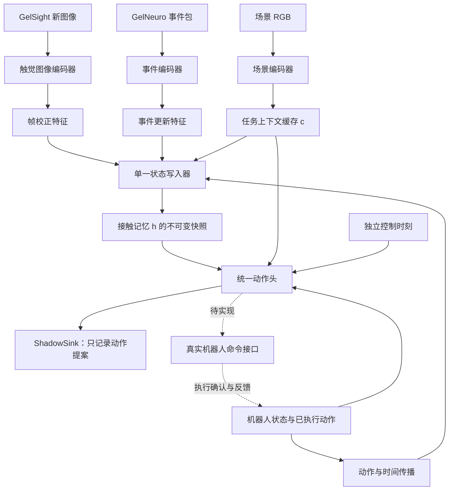

# 架构约定

本文件依据用户给出的 NeuroFusion 大纲整理。256 维记忆、128 维上下文、5 维动作与 50 Hz 均是候选起点，不是完成验证的模型与性能。

## 模型边界

- 图像/事件采集与编码的工作线程未来产生特征消息；发布时标记**特征实际可用的主机单调时间**，不能把昂贵编码隐藏在已到达时间之前。
- 三路更新分别为 `FrameCorrection`、`GatedEventUpdate`、`ActionTimePropagation`；它们写同一 `h`，不各建一个互相竞争的动作策略。
- `Snapshot` 当前用不可变 Python tuple 表达接口，便于无依赖验证。正式学习实现再接入张量和推理设备；运行中的 `h` 改变，模型权重通常保持固定。
- `RegressionActionHead` 预留 `concat(h,c,q) -> 小型 MLP -> 当前动作` 路线，层数、宽度和归一化未定；不预设 Diffusion/Flow Matching。
- `FutureTactileAuxiliaryHead` 为可选训练辅助模块，不作为机器人命令来源。

## 更新与控制节奏

`Engine` 是同一线程持有的参考顺序驱动，不创建传感器线程，也不保证硬实时。输入按 `(available_ns, kind_priority, ingress_sequence)` 排序；同一可用时间且已入队的消息依次为上下文、机器人状态、已执行动作、帧、事件、控制。相同来源同时间按入队顺序稳定处理。

每条消息先用上一状态的 `q` 与已执行动作传播至当前时间，再校正相应字段；控制时刻只在传播后读取快照并产生提案。动作头不直接改写状态。发送动作提案不会自动生成“已执行动作”，必须由未来的反馈接口确认。

该顺序只适用于已经可用并入队的消息。处理过控制时刻后才发布的同时间观测，不会追溯改写旧动作。主机可用时间早于已处理时间的输入会报错；设备时间旧而接收时间新是正常迟到观测，保留其设备时间供后续同步模块解释，不使用设备时间直接重排。

只有状态拥有线程能入队和推进；回调不可重入。未来多线程采集需增加有界线程间邮箱，再由单写入者消费。队列满会明确失败，尚未决定事件合并、丢弃、优先级或超时恢复策略。状态快照保存版本和最近帧/事件时间，后续可记录观测年龄与实际时延。

## 时钟与动作

- `available_ns`：统一主机单调时钟中，输入或编码特征可被消费的时刻。
- `received_ns`：可选主机接收时刻，不替代每个事件的产生时间。
- `device_us` 与事件包设备起止时间：原样保留的设备时钟，未同步前不跨源比较。
- 演示用逻辑相对纳秒时间，不能由其计算真实调度耗时。
- 暂定动作顺序：`dx_m, dy_m, dz_m, dyaw_rad, dgripper_width_m`。坐标系、增量参考、范围、开度正方向和频率仍需对照实际机器人定义。
- 当前只提供 `ShadowSink`；真实命令接口明确抛出 `NotImplementedError`。没有已验证的动作限幅、停止、超时保护、通信或机械执行能力。

## 后续验证顺序

实施依照[主机数据流规划v2](../../项目规划/README.md)和[组件验证方案](../../项目规划/组件实现与验证.md)：

1. H01：已有真实事件进入正式输入/封包/消息边界，建立最小因果追踪，不先做完整回放GUI。
2. H02：尽早用小型编码器、时间表示、三路更新与统一动作头接成可训练链；合成样例只验工程。
3. H03/H04：围绕具体问题逐路补真实输入/标签，模块单测后接回整体，做固定条件替换和必要的联合微调。
4. H05：实现实际主机异步采集/编码、单写入者和独立控制读取，逐段测量计算/排队/年龄；现有Engine不保证该能力。
5. H06/H07：接通同一策略的CMD→控制器→Q反馈，在最小接触任务中验动作和有效响应。

片上迁移、独立反射复现和水下机器鱼不作为这条主线的前置。支持测量按实际加入的组件逐段补充；逻辑接线和软件耗时不构成物理及时反应保证。
