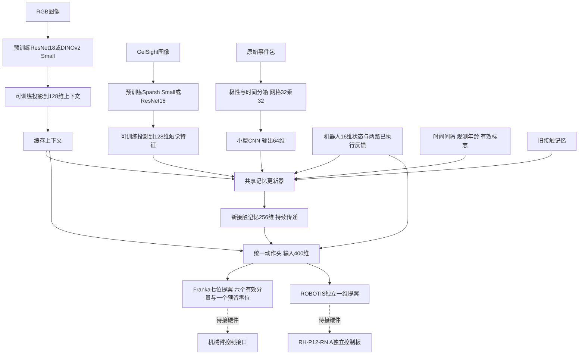

> 2026-11-04夹爪实机收尾：用户确认没有手动移动但夹爪曾自行张开，根因未明，运动入口已锁住。只读反馈和电机关闭状态下的目标寄存器写入/回读通过；实际受控开合未通过。实机结束时使能0、电流0、目标预置为当前实测位置。

> 2026-11-04增量：已新增独立ROBOTIS反馈/有界动作适配器，临时q[15]约定与当前实测边界见[夹爪接入](robotis-gripper.md)。本页其余网络主体保持不变。

# 已实现的主机网络与规划差异（2026-11-03）

对应项目规划/已实现网络结构_2026-11-03.md。

本页以 WSL 正式仓库源码和软件检查为依据。完成的是可训练、可回放推理的主机网络；没有连接 Franka 或 ROBOTIS，没有完成真实接触训练、物理闭环和实时调度。辅助预测仍为待研究内容。

## 1. 当前真实网络结构



输入不同步时不拼造同一时刻的全套观测：RGB新输入只刷新上下文；触觉帧/事件到来分别编码和更新记忆；每条消息先按上一份机器人状态及实际执行反馈传播到当前可用时刻，再吸收本条消息。控制消息也会推进记忆，再读动作。相同时刻沿调用方显式提供的顺序处理，零时间间隔不重复传播。训练使用Tensor保留历史梯度，推理沿同一套step/rollout逻辑运行。

本轮采用新的Tensor主链，不把旧tuple参考Engine当作训练器。新主链是因果顺序回放，不是已经运行的传感器并发线程或硬实时控制器。调用方需在编码真正完成后发布在线可用时间；软件回放中给定的逻辑时间不是本机实测耗时。

## 2. 三种接触记忆融合

三种方式可切换，当前默认attention。三路更新是功能角色，**共用一套更新器参数**，用输入类型标识区分图像、事件和传播；没有额外写三个完全独立的模型。

| 方式 | 已实现结构 |
|---|---|
| plain普通融合 | 新观测、上下文、机器人/执行动作、时间各映射到128维；与256维旧记忆拼接为768维；MLP 768→256→256直接输出新记忆 |
| gated门控融合 | 与plain相同候选网络，再用768→256的sigmoid门；按逐维接受比例混合旧记忆与候选记忆 |
| attention注意力融合 | 256维记忆重排为4个64维记忆token；4类输入各映射为64维token；旧记忆作为query，读取4个旧记忆token和4个输入token；4头cross-attention，残差/LayerNorm，前馈64→128→64与第二次残差/LayerNorm，写回256维 |

attention有可训练的记忆槽位及来源嵌入，没有额外显式门控，也不随时间追加无限历史。历史保存于传递的记忆状态，QKV投影权重在推理时固定。当前图像骨干的输出先池化再投影，每次图像/事件观测形成一个摘要token；**尚未把全部图像patch或逐个事件当token**。这是控制成本的首版取舍，不把它称为已经验证的最优表征。

时间输入为：本次经过时间、此前触觉帧年龄及有效性、此前事件年龄及有效性、本条观测年龄；以秒为单位经过log1p和MLP。图像/事件需显式提供映射到主机时钟的采集/窗口关闭时刻，缺失或未来采集时刻会报错，不补造真实时间。暂未单独维护RGB缓存年龄输入；这是与完整规划相比仍需补充的内容。

无新观测时，更新器仍读取动作/时间进行传播；零间隔保持原记忆。每个回合显式initial_state重置，可用state.detach()截断反向传播；当前训练入口对给定整段展开，长回合应由数据准备切成合适的因果训练窗口，尚未实现自动预热/截断窗口调度。

| 融合网络 | 实际参数量 |
|---|---:|
| plain | 324,992 |
| gated | 521,856 |
| attention | 61,056 |

## 3. 事件编码与图像接入

事件列顺序固定为`x,y,device_us,polarity`，极性0/1。设备窗为左闭右开`[start_us,end_us)`；校验坐标、时间窗、顺序、有限值，允许真正的空事件包。128×128是首版传感器尺寸起点，映射到32×32网格，4个时间分箱×2个极性得到8通道，计数后log1p。

事件网络：Conv 8→16、16→32、32→64，均3×3/stride2并接SiLU；自适应池化为2×2，展平256→Linear64。参数量40752。这是可训练的主机事件基线，不是SNN、二值滑移器或已训练好的接触识别器。原始事件的设备时钟与主机时钟映射仍由输入适配器提供；网络不猜测跨时钟映射。

RGB默认ResNet18，GelSight默认Sparsh-DINO Small，均严格加载已下载官方权重并冻结骨干；输出投影保留梯度。可通过配置切换DINOv2-Small及单帧触觉ResNet18。Sparsh输入必须由真实当前/历史帧与背景通过已有prepare_sparsh预处理为六通道；合成检查使用随机六通道输入，只检验工程连接。没有新图像时不重复编码，旧上下文及接触信息通过状态保留。

## 4. 动作合同：Franka与独立ROBOTIS

按用户确认，机械臂先采用**六个有效运动分量＋一位预留**，不是把Franka七个关节里的最后一个关节丢弃。具体为关节、笛卡尔位姿/速度中的何种接口、坐标和单位，仍待确认。机器人状态16维也是可配置候选，尚未锁定实机反馈字段和归一化；数据提供方必须在训练/推理中保持一致尺度。

夹爪为ROBOTIS RH-P12-RN(A)，独立连接上位机/夹爪控制板，**不经Franka夹爪接口**。首版夹爪动作采用一维可配置命令占位，后续确认位置/速度/电流等控制模式及单位，不能把它直接当电机寄存器值。

统一网络学习7个有效输出：6个机械臂运动量＋1个夹爪量。对外打包为8位：

```text
[arm_motion_0 ... arm_motion_5, arm_reserved_zero, robotis_gripper]
```

第7位始终补零，无预测参数且不参与损失；机械臂提案取前7位，夹爪单独取第8位。两路共用一个策略，不是两个竞争控制器。两路已执行反馈分别输入，更新其中一路不会抹掉另一路；生成提案不自动回填为执行反馈。

训练集有效动作的min/max中心与半范围拟合归一化，验证集不重新拟合；保存在模型buffer/检查点。推理可输出归一化值或还原到标签单位，未拟合时禁止声称物理单位输出。合成检查还原的是合成标签尺度，不是已标定的实机量。仍无命令限幅、坐标映射、SDK发送、执行确认和实机时限保证。

| 动作头 | 实际参数量（7个有效输出） |
|---|---:|
| mlp | 170,247 |
| act | 5,477,448 |
| diffusion_unet | 4,433,927 |
| diffusion_transformer | 4,850,951 |

MLP为400→256→256→7，归一化Smooth L1训练；ACT沿用前轮条件适配的Transformer/CVAE，长度16；DP U-Net/Transformer为同长度动作块，100训练扩散步/默认10步DDIM采样。ACT使用L1+KL，扩散使用噪声预测损失。输出动作块时每次控制读取只取首个动作，仍需验证推理周期成本。本轮动作头没有现成任务权重，需真实示教训练。

## 5. 运行与真实数据合同

```bash
cd ~/neurofusion/neurofusion
conda activate minist
python -m neurofusion.training.pipeline --steps 3 --output outputs/my-run.json --checkpoint outputs/my-run.pt
python -m neurofusion.training.pipeline --fusion plain --head mlp --steps 3
python -m neurofusion.training.pipeline --fusion gated --head act --steps 3
python -m unittest discover -s tests -v
```

未指定`--data`时为明确标记的合成输入和合成标签，只做链路训练调试；`--data train.pt --validation-data val.pt`可接收用户整理好的真实序列。提供`--device cuda`需训练机已安装CUDA版PyTorch，本机目前仍为CPU验证环境。输出和检查点不覆盖已有文件。

数据文件通过`torch.save`保存纯字典/张量：`observations`为消息字典列表，`targets`为每个control消息对应的一份动作标签。消息字段对应Observation：`kind, available_ns, value, captured_ns, start_us, end_us`；只有event使用设备窗字段。kind为rgb/frame/event/robot/arm_executed/gripper_executed/control。图像BCHW，事件为每个batch成员一个Nx4张量，机器人B×16、机械臂已执行反馈B×7且预留零、夹爪反馈B×1。每个batch成员共用一份可用时间网格，不支持未对齐的逐样本独立时间轴。

MLP标签为B×8，动作块标签B×16×8；均为完整有效标签，尚不支持缺失/填充监督。多设备反馈必须来自真实执行日志，不使用模型提案替代。动作窗口、设备单位、训练/验证按回合划分及时间映射由数据准备负责；本轮没有实现自动采集/通用数据集转换，也未完成H01历史CSV接入。只加载纯张量字典的weights_only模式，不执行任意对象pickle。

接口位置：`models/policy.py`（可微状态与step/rollout/propose）、`fusion.py`（三类更新）、`events.py`（事件编码）、`split_actions.py`（动作打包/归一化/分路）、`training/pipeline.py`（序列训练及检查点）、`configs/pipeline.toml`（新主链配置）。

## 6. 与此前规划的差异和证据

| 此前内容 | 本次实际结果 |
|---|---|
| 三路更新和attention只是候选 | 已实现三种共享参数更新器，默认4个64维记忆token的attention |
| 只有tuple参考驱动，不能训练记忆 | 新增同一step逻辑的Tensor序列训练/推理，保留历史梯度；旧Engine不改为可微 |
| 事件编码待实现 | 实现原始包到体素网格与CNN的主机基线，尚无真实接触训练证据 |
| 暂定五维平移/偏航/夹爪 | 新主链改为6有效臂分量＋臂预留零位＋独立夹爪，外部8维；旧5维只保留历史demo和既有测试 |
| FG/FE/FP可能是三个独立网络 | 本次共享一个更新器，以类型嵌入区分职责；可后续比较独立网络 |
| 普通融合可能加入辅助预测 | 本轮三种方式统一只用动作监督，辅助预测及其消融仍待研究，未实现 |
| 完整传感器/机械臂闭环 | 仅软件序列链和分路提案；输入实时采集、跨设备时钟与真实执行仍待接入 |

默认配置总参数33,457,655，可训练参数386,999。`outputs/pipeline-verified.json`记录3步合成训练损失0.3017 → 0.2701 → 0.2358，五个分支均有非零梯度、冻结骨干无梯度；检查点恢复后记忆数值一致。22项unittest通过；`outputs/pipeline-matrix.json`记录3融合×4动作头共12组完整网络的一步训练及推理检查。权重骨干真实加载，输入和动作标签合成，均未向机器人发命令。损失下降是调试证据，不是任务效果、实时频率或泛化结论。

后续优先：准备有来源、时序可信的真实接触/动作序列，验证当前事件编码和记忆是否改善留出动作表现；再接入两路真实执行接口并测物理响应。时延、CPU/GPU预算、跨任务和辅助预测尚未验证。
